# Day 3: roofline model

**Stage:** 2, GPU architecture and modern silicon. **Label:** M (measured on this machine) and L
(vendor specifications, nothing run). **Date:** 2026-11-23. **Time spent:** elapsed 11:00 to 22:30,
most of it waiting for the machine to be quiet. Hands-on time was not recorded.

## Goal

A roofline says a kernel that does F floating-point operations and moves B bytes cannot run faster
than min(peak compute, memory bandwidth x F / B). Today builds that calculator, fills it with the
vendor-printed figures for datacentre GPUs (label L), measures this chip's real memory bandwidth and
matrix-multiply throughput on its GPU through MLX (label M), and places measured points on this
chip's own roofline, including the decode-shaped product (a small batch times one large weight
matrix) that Day 6 will use to predict decode speed.

How the results were judged: five predictions were written in `src/inferlab/roofline.py` and
committed before the gated measurements (commit f6ee243, see "What failed or surprised me" for what
that does and does not prove). Each measurement phase ran three times as independent processes, had
to repeat within 10% (fixed before the first run), and was bracketed by a decode probe that must be
within 20% of Day 1's baseline. A phase that did not repeat was written down, kept, and not cited.
Which files may be cited is in [`results/README.md`](results/README.md).

## Environment

- MacBook Air (Mac15,12): Apple M3, 4 performance and 4 efficiency cores, 10-core GPU, 16 GB, no
  fan. macOS 26.2, Python 3.12.8.
- MLX 0.32.4 with `mlx-metal` 0.32.4, installed only in this repository's `.venv` after you
  approved the download (two files, 667,622 and 78,106,861 bytes, sha256 in `LOG.md`). MLX reports
  `Device(gpu, 0)`, Apple M3, architecture `applegpu_g15g`, recommended working set 12,713,115,648
  bytes.
- On AC power (battery 100%) for the measurements. Free disk was 3.0 to 5.5 GiB all day, below the
  runbook's 8 GB rule, which you chose to waive for this day (about 80 MB of this repository's
  writes). Thermal state was not recorded: `pmset -g therm` reports nothing on this chip.
- Code: the calculator, scripts and checks are commits f6ee243, a8dce0f and aa64500. The `--rest`
  option of `scripts/day03_run.py`, used for the third decode-sweep attempt, was added after the
  first two attempts and is committed with the results.
- The machine was not idle: Chrome, a video player (VLC), window and system services ran
  throughout. What the neighbour sampler saw is in each result file under `neighbours`.

## What I did

1. Built the calculator (`src/inferlab/roofline.py`) with its five predictions, and committed it
   before measuring anything that counts.
2. Fetched each vendor page on 2026-11-23 and recorded every figure in
   `specs/hardware_specs.json` with its URL, fetch date, the text as printed or the derivation
   rule. A validator refuses a figure with no source, and a test recomputes every derived figure.
3. Installed MLX with your approval, wrote the worker that runs one phase in one process, the
   gated runner, and the analysis, with tests and 28 new deliberate-bug checks in
   `scripts/mutation_check.py` (all caught).
4. Ran the three measurement phases, each gated on a quiet machine and a decode probe before and
   after: `python scripts/day03_run.py`. Bandwidth and matrix multiply held on the first try. The
   decode sweep did not (two rejected attempts, below).
5. Re-ran only the decode sweep with a 240 s rest before each of the three runs:
   `python scripts/day03_run.py --only skinny --rest 240 --wait-quiet 300`. It held.
6. Rendered every table and the chart from the result files: `python scripts/day03_report.py`.
   Looking at the chart found two bugs (below).

## Results

### Vendor specification figures (label L)

Fetched 2026-11-23. A figure marked "derived" is not printed by the vendor: NVIDIA prints dense
half-precision compute for the H100 and H200 only with sparsity, and for the B200 only for an
8-GPU baseboard, so the dense and per-GPU figures here are halved (NVIDIA's own footnote) and divided
by eight. The A100's dense figure is printed. Apple prints no FLOPS figure for the M3, so this
chip's compute roofs come from measurement only. The last column is the batch size where a decode
product (8192 x 8192 weights in half precision) reaches the ridge point, from the formula in
`knee_batch`.

| Device | Memory bandwidth | FP16/BF16 tensor, dense | FP32 | Ridge, FLOP/byte | Decode batch to reach the ridge (fp16 weights) |
|---|---|---|---|---|---|
| NVIDIA A100 80GB SXM | 2039 GB/s | 312 TFLOPS | 19.5 TFLOPS | 153 | 159 |
| NVIDIA H100 SXM | 3.35 TB/s | 989.5 TFLOPS (derived) | 67 TFLOPS | 295 | 318 |
| NVIDIA H200 SXM | 4.8 TB/s | 989.5 TFLOPS (derived) | 67 TFLOPS | 206 | 217 |
| NVIDIA B200 SXM (per GPU) | up to 8 TB/s | 2250 TFLOPS (derived) | not published by the vendor | 281 | 302 |
| AMD Instinct MI300X | 5.3 TB/s | 1307.4 TFLOPS | 163.4 TFLOPS | 247 | 262 |
| Apple M3 (this machine: 10-core GPU, 16 GB) | 100 GB/s | not published by the vendor | not published by the vendor | not published | not published |

### Measured on this chip (label M)

Each number is the median over 3 independent process runs, each the fastest of 8 timing samples. The
roofs are the best stable measurement on this machine, not vendor figures, so "fraction of roofline"
means how close a point is to the best this chip reached here, not to a theoretical peak. The
bandwidth roof is the best of the four streaming kernels (the read-only `sum`). The fp32 and fp16
compute roofs are the best square matrix multiply of each precision.

#### Roofs

| Roof | Peak TFLOPS | Bandwidth GB/s | Ridge, FLOP/byte | Where it comes from |
|---|---|---|---|---|
| GPU, half precision | 3.08 | 90.9 | 33.9 | measured today through MLX |
| GPU, single precision | 2.78 | 90.9 | 30.5 | measured today through MLX |
| CPU, single precision | 1.65 | 85.1 | 19.4 | measured on Day 2 |

#### Streaming bandwidth on the GPU

| Kernel | Bytes moved per element | GB/s, median (min to max) | Variation |
|---|---|---|---|
| scale | 8 | 86.7 (83.7 to 87.0) | 1.7% |
| add | 12 | 85.4 (83.6 to 85.5) | 1.1% |
| triad | 12 | 87.2 (83.9 to 89.2) | 2.5% |
| sum | 4 | 90.9 (90.7 to 94.4) | 1.8% |

#### Matrix multiply on the GPU

| TFLOPS, median (min to max) | n=512 | n=1024 | n=2048 | n=4096 |
|---|---|---|---|---|
| fp32 | 2.02 (2.01 to 2.03) | 2.78 (2.77 to 2.78) | 2.73 (2.72 to 2.79) | 2.59 (2.52 to 2.63) |
| fp16 | 2.24 (2.15 to 2.24) | 3.07 (2.95 to 3.08) | 3.08 (2.99 to 3.09) | 3.05 (2.88 to 3.06) |
| bf16 | 2.24 (2.21 to 2.24) | 3.08 (3.06 to 3.08) | 3.09 (3.08 to 3.09) | 3.06 (3.02 to 3.06) |

#### Decode-shaped products on the GPU

| Batch | Intensity, FLOP/byte | TFLOPS | Weight traffic, GB/s | Fraction of roofline | Bound |
|---|---|---|---|---|---|
| 1 | 1 | 0.09 | 90.1 | 99% | memory |
| 2 | 2 | 0.17 | 83.1 | 91% | memory |
| 4 | 4 | 0.32 | 81.0 | 89% | memory |
| 8 | 7.98 | 0.64 | 80.3 | 88% | memory |
| 16 | 15.9 | 1.31 | 82.2 | 90% | memory |
| 32 | 31.8 | 1.48 | 46.5 | 51% | memory |
| 64 | 63 | 3.01 | 47.8 | 98% | compute |
| 128 | 124 | 3.01 | 24.3 | 98% | compute |
| 256 | 241 | 3.01 | 12.5 | 98% | compute |
| 512 | 455 | 3.02 | 6.6 | 98% | compute |
| 1024 | 819 | 3.01 | 3.7 | 98% | compute |

#### Every measured point against its roofline

| Series | Point | Intensity, FLOP/byte | Achieved GFLOPS | Roofline GFLOPS | Fraction of roofline | Bound |
|---|---|---|---|---|---|---|
| stream | scale | 0.125 | 11 | 11 | 95% | memory |
| stream | add | 0.0833 | 7 | 8 | 94% | memory |
| stream | triad | 0.167 | 15 | 15 | 96% | memory |
| stream | sum | 0.25 | 23 | 23 | 100% | memory |
| matmul fp32 | fp32-512 | 85.3 | 2016 | 2775 | 73% | compute |
| matmul fp32 | fp32-1024 | 171 | 2775 | 2775 | 100% | compute |
| matmul fp32 | fp32-2048 | 341 | 2733 | 2775 | 98% | compute |
| matmul fp32 | fp32-4096 | 683 | 2590 | 2775 | 93% | compute |
| matmul fp16 | fp16-512 | 171 | 2236 | 3084 | 73% | compute |
| matmul fp16 | fp16-1024 | 341 | 3072 | 3084 | 100% | compute |
| matmul fp16 | fp16-2048 | 683 | 3084 | 3084 | 100% | compute |
| matmul fp16 | fp16-4096 | 1.37e+03 | 3051 | 3084 | 99% | compute |
| matmul bf16 | bf16-512 | 171 | 2236 | 3084 | 72% | compute |
| matmul bf16 | bf16-1024 | 341 | 3082 | 3084 | 100% | compute |
| matmul bf16 | bf16-2048 | 683 | 3087 | 3084 | 100% | compute |
| matmul bf16 | bf16-4096 | 1.37e+03 | 3056 | 3084 | 99% | compute |
| decode batch | batch-1 | 1 | 90 | 91 | 99% | memory |
| decode batch | batch-2 | 2 | 166 | 182 | 91% | memory |
| decode batch | batch-4 | 4 | 324 | 363 | 89% | memory |
| decode batch | batch-8 | 7.98 | 641 | 726 | 88% | memory |
| decode batch | batch-16 | 15.9 | 1309 | 1449 | 90% | memory |
| decode batch | batch-32 | 31.8 | 1477 | 2886 | 51% | memory |
| decode batch | batch-64 | 63 | 3012 | 3084 | 98% | compute |
| decode batch | batch-128 | 124 | 3015 | 3084 | 98% | compute |
| decode batch | batch-256 | 241 | 3010 | 3084 | 98% | compute |
| decode batch | batch-512 | 455 | 3024 | 3084 | 98% | compute |
| decode batch | batch-1024 | 819 | 3010 | 3084 | 98% | compute |

#### Predictions

| Prediction | Result |
|---|---|
| Triad bandwidth between 60 and 100 GB/s | held |
| fp32 n=4096 between 1.0 and 4.0 TFLOPS; fp16 at least 0.9 of it; n=4096 at least 1.2 times n=512 | held |
| Decode sweep: never above its roofline; memory-bound and compute-bound regions reach their floors | held |

#### Machine speed before and after each phase

| Phase | Decode probe before, tokens/s | Decode probe after, tokens/s |
|---|---|---|
| bandwidth | 154.7 | 157.3 |
| matmul | 156.9 | 151.9 |
| skinny | 154.8 | 158.4 |

The same roofs and points on one chart, with the datacentre parts' roofs from the vendor figures
above (the GPU roofs bold, this chip's CPU from Day 2 dashed):

What these numbers show:

- **Streaming bandwidth is 85 to 91 GB/s through MLX.** Triad, the STREAM kernel, is 87.2 GB/s, 87%
  of the 100 GB/s Apple prints for this chip. The read-only `sum` reached 90.9, 91% of it. Day 2's
  CPU triad was 85.1 GB/s. The CPU and GPU draw on one memory, so close numbers are expected, though
  I did not test whether both can reach their speed at once.
- **The GPU's compute roofs are 2.78 TFLOPS in single precision and 3.08 in half precision, and the
  half-precision gain is small.** Half precision was 11% to 18% faster than single precision from
  n=1024 up, nowhere near double. bf16 matched fp16 to within 0.4% from n=1024 up. The GPU's single
  precision peak is about 1.7 times the CPU's best Accelerate result from Day 2 (1.65 TFLOPS).
- **The ridge point is low: 30 to 34 FLOP per byte for this chip's GPU.** The datacentre parts' ridges, from printed
  peaks, are 153 to 295. A decode product on this chip reaches the ridge at a batch of about 34
  (from measured roofs), against 159 to 318 for the datacentre parts (from printed peaks). That is
  not a like-for-like comparison: a printed peak is a ceiling, and a real kernel on those parts
  would reach less compute and so a lower ridge.
- **The decode sweep follows the roofline at both ends.** For batches 1 to 16 the product moved
  80 to 90 GB/s of weights, 88% to 99% of its memory roofline, and at batch 16 it did more than 14
  times the work per second of batch 1 for the same weights read. From batch 64 up it ran at 3.01 to 3.02
  TFLOPS, 98% of the half-precision compute roof.
- **Batch 32 is the exception.** It sits just below the predicted knee (34.2), where the model says
  memory-bound with up to 2.9 TFLOPS available, and it reached 1.48 TFLOPS, 51% of its roofline. I
  measured no batch between 32 and 64, so the data place the transition inside that gap, which
  contains the predicted knee, but near the ridge this roofline overstates what the chip does by up
  to a factor of two. I did not find out why.

## What failed or surprised me

- **The decode sweep took three attempts.** Attempt 1 had batches 64 to 512 vary 10% to 25% between
  runs (limit 10%) while an Apple system process, `ANECompilerService`, used up to 90% of a core.
  Attempt 2, started under two minutes later, had no contention flag but batches 64 to 256 still
  varied 10.4% to 11.1%. In both, the runs got slower one after another, while the decode probe showed no
  drift. It measures a memory-bound workload, which may be why it missed this. Both files are kept in
  [`results/rejected/`](results/rejected/README.md) and none of their numbers is used. I then added
  an optional rest between runs and re-ran: attempt 3 repeated within 1.0% in every batch. That is
  consistent with the slowdown being a fanless machine under sustained load, but I read no
  temperature or clock, and the neighbour sampler flagged attempt 3 as contended too. I changed the
  protocol after seeing the failures and only for this phase, so the bandwidth and matrix-multiply
  phases ran back to back without rests. The 10% limit never changed.
- **The contended flag on attempt 3 cannot be read as it stands.** The sampler runs during the rests
  as well, so its peak (263% of a core for all other processes together; the busiest were Chrome,
  `bird`, `duetexpertd` and `IntelligencePlatformComputeService`) may have come entirely from the
  idle gaps. The documented
  rule is that the run-to-run variation decides stability, and all three runs agreed within 1.0%.
  I cite the file on that basis and say so here.
- **The predictions were not fully blind.** Before the gated runs I ran each worker once, un-gated,
  to see that the code worked, and I saw streaming near 70 to 90 GB/s and matrix multiply of 2 to 3
  TFLOPS. Those outputs were not saved or used, but the ranges I committed beforehand were written
  before that look, and the commit order is the evidence of that. Prediction 4 (n=4096 at least 1.2
  times n=512) held narrowly: 1.28 times.
- **The chart had two bugs that no test or table showed.** The `add` kernel's point (7 GFLOPS) was
  below the lowest axis line and so invisible, and the axis title overlapped the tick labels. I
  fixed the axis range and margins and added tests for both.
- **Two spec readings were wrong the first time.** Subagents read the A100's "156 | 312" cell as
  PCIe against SXM when it is one merged dense and with-sparsity cell, which would have halved the
  A100's roof, and reported the B200's per-GPU bandwidth and the M3's 100 GB/s as not found. I
  rechecked every figure against the raw pages (details in `LOG.md`).
- **A CI check would have failed.** `scripts/mutation_check.py` was committed without the formatter,
  and CI runs `ruff format --check`. I found it before pushing and reformatted (quote style only,
  the parsed program is identical).

## Not claimed

- **Why the compute roofs behave as they do**: why half precision is only 11% to 18% faster, why
  n=512 reaches only 73% of the roof, why fp32 at n=4096 is 7% below its n=1024 value, or why batch
  32 is at 51%. I did not isolate any of them.
- **That heat explains the rejected decode sweeps.** It is a hypothesis.
- **The datacentre figures as measurements.** They are vendor-printed peaks (label L), fetched
  2026-11-23, and the derived ones are arithmetic on printed figures.
- **That MLX's kernels are the best this GPU can do.** A hand-written Metal kernel might reach more;
  the roofs here are the best MLX reached.
- **Sustained throughput.** The roofs describe a machine that has rested; the rejected attempts ran
  slower and I did not establish why.

## Limits

- One machine, one run session, and not an idle machine: Chrome, VLC and system services were
  running. GPU use by other processes was checked only at the start of each phase (the pre-flight
  refuses a peak above 25% or a mean above 5%) and not during the runs, so a video player using
  the GPU mid-run would not have been seen. The end-of-phase GPU readings in the result files were
  taken right after the decode probe and cannot separate that probe's use from anyone else's.
- The decode product is one shape (a batch times an 8192 x 8192 half-precision matrix), checked
  against the minimum possible memory traffic. Real transformer layers add attention, other
  shapes, and caches.
- Square matrix sizes only for the compute roofs, up to n=4096.
- The decode probe measures a memory-bound workload, so it cannot detect a compute slowdown, which
  is what the rejected attempts showed.

## Evidence ledger entries

The rows added to [EVIDENCE.md](../../EVIDENCE.md) today:

- Streaming bandwidth of the M3 GPU through MLX (M).
- Square matrix multiply peaks and precision comparison (M).
- The decode-shaped sweep against the measured roofline, with the two rejected attempts disclosed (M).
- Measured bandwidth against Apple's printed 100 GB/s (M, L).
- The specification table and ridge points for five datacentre GPUs (L, studied only).
- Built things: the roofline calculator, the specification validator, the chart and their tests.
